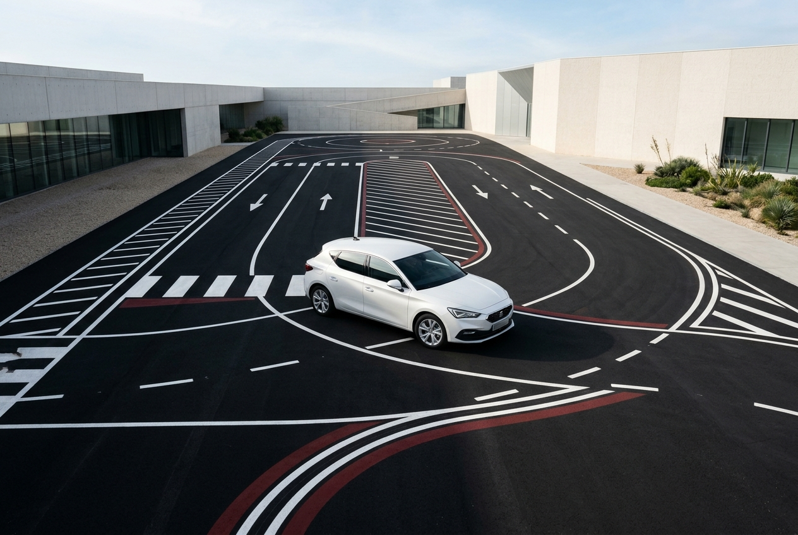
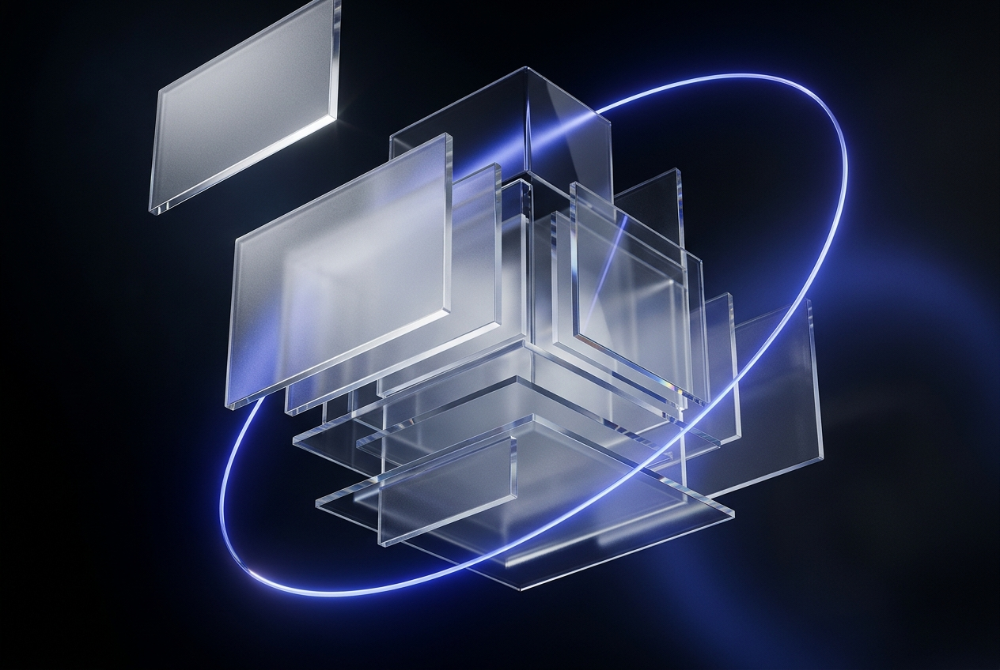

<div align="center">
  <table style="border: none; background: transparent; margin: 0 auto;">
    <tr>
      <td align="center" style="background-color: #050505; border: 1px solid rgba(255, 255, 255, 0.12); border-radius: 20px; padding: 36px 48px;">
        <a href="https://github.com/Balashanmugam30/Ostrum">
          
        </a>
        <br />
        <p style="margin-top: 14px; margin-bottom: 0; color: #FFFFFF; font-family: -apple-system, BlinkMacSystemFont, 'Segoe UI', Roboto, sans-serif; font-size: 13px; letter-spacing: 0.22em; text-transform: uppercase; font-weight: 600;">
          Digital Experience &amp; Technology Studio
        </p>
      </td>
    </tr>
  </table>

  <p align="center" style="margin-top: 20px;">
    <strong>Next.js 15 App Router &bull; React 19 &bull; TypeScript &bull; Tailwind CSS &bull; GSAP &bull; Three.js &bull; Resend</strong>
  </p>

  <p align="center">
    <a href="#about-ostrum">About</a> &bull;
    <a href="#what-we-build">What We Build</a> &bull;
    <a href="#selected-work">Selected Work</a> &bull;
    <a href="#design-principles">Design Principles</a> &bull;
    <a href="#technology-stack">Tech Stack</a> &bull;
    <a href="#getting-started">Getting Started</a> &bull;
    <a href="#documentation">Documentation</a>
  </p>
</div>

---

## 1. About OSTRUM

**OSTRUM is a digital experience and technology studio.** We engineer high-performance software, AI-enabled intelligence platforms, custom operational business systems, and connected digital products for ambitious enterprises and founders.

Our practice unites art-directed design, spatial motion, and resilient full-stack engineering. We replace fragmented digital stacks with cohesive, interconnected systems engineered to scale reliably without operational friction.

---

## 2. What We Build

- **Digital Experiences:** Cinematic web platforms, interactive 3D WebGL environments, fluid scroll journeys, and responsive brand storefronts built for lasting impressions.
- **AI Systems & Agents:** Autonomous workflow automation, intelligent inquiry triage, context-aware notification pipelines, and structured multimodal processing.
- **Business Platforms:** Operational dispatch backends, client intelligence platforms, booking coordination systems, and custom administrative management tools.
- **Software & Product Engineering:** Full-stack Next.js applications, high-throughput serverless API routes, relational database architectures, and hardened cloud integrations.
- **Connected Technology:** Real-time mobile dispatch, native OS system integrations, and device communication protocols.
- **Custom Engineering:** Bespoke digital solutions designed from first principles for problems that defy standard off-the-shelf software.

---

## 3. Selected Work

<table width="100%">
  <tr>
    <td width="33%" valign="top">
      <a href="https://tmraicarcare.com/">
        
      </a>
      <h3 style="margin-top: 12px; margin-bottom: 4px;">
        <a href="https://tmraicarcare.com/">TMR AI Car Care &nearr;</a>
      </h3>
      <p style="font-size: 13px; line-height: 1.5; color: #555;">
        <strong>Client System &bull; Live Production</strong><br />
        Autonomous workflow and client intelligence platform built for high-precision luxury automotive detailing, 10H ceramic protection, and surface restoration studios in Tiruppur.
      </p>
    </td>
    <td width="33%" valign="top">
      <a href="https://saraswati-driving-school.vercel.app/">
        
      </a>
      <h3 style="margin-top: 12px; margin-bottom: 4px;">
        <a href="https://saraswati-driving-school.vercel.app/">Saraswati Driving School &nearr;</a>
      </h3>
      <p style="font-size: 13px; line-height: 1.5; color: #555;">
        <strong>Client System &bull; Live Production</strong><br />
        Modern scheduling, training course coordination, and fleet logistics infrastructure engineered for certified driver education and complete A-Z RTO services in Tiruppur.
      </p>
    </td>
    <td width="33%" valign="top">
      <a href="https://github.com/Balashanmugam30/mnesa">
        
      </a>
      <h3 style="margin-top: 12px; margin-bottom: 4px;">
        <a href="https://github.com/Balashanmugam30/mnesa">MNESA &nearr;</a>
      </h3>
      <p style="font-size: 13px; line-height: 1.5; color: #555;">
        <strong>Studio Venture &bull; Open-Source</strong><br />
        AI-powered opportunity capture and follow-through platform that captures high-value career and educational opportunities in under 200ms and orchestrates proactive reminder cadences.
      </p>
    </td>
  </tr>
</table>

---

## 4. OSTRUM Design Principles

1. **Purposeful Motion:** Motion is treated as an architectural material. Scroll-scrubbed typography fills, pinned reading holds, and theatre-curtain transitions guide attention naturally without disorienting the reader.
2. **Typographic Discipline:** Monumental optical serif headlines paired with high-legibility grotesque body text and precise monospaced telemetry kickers.
3. **Disciplined Color Palette:**
   - **Deep Crimson:** `#64120F` &mdash; Foundational studio footer stage and primary brand ground.
   - **Signature Vermilion:** `#C9362B` / `#FF4D30` &mdash; Energy accents, active highlights, and traveling luminous beams.
   - **Obsidian Black:** `#050505` &mdash; High-contrast text, Liquid Sand CTA surface, and dark-mode stages.
   - **Pure White / Alabaster:** `#FFFFFF` &mdash; Editorial reading surface and crisp high-contrast cards.
4. **Original Visual Assets:** Custom 3D geometries, mathematical WebGL caustics, and purpose-generated project artwork.
5. **Accessibility by Default:** High-contrast text ratios, visible focus indicators, native keyboard navigation, and automatic non-scrubbed static presentation when `prefers-reduced-motion` is enabled.

---

## 5. Technology Stack

- **Framework:** Next.js 15+ (App Router with React Server Components & Static Site Generation)
- **UI & State:** React 19, TypeScript (Strict Mode)
- **Styling:** Tailwind CSS, CSS Custom Properties, and responsive viewport sizing (`100svh`)
- **Animation & Scroll Choreography:** GSAP 3, ScrollTrigger (pinned chapter choreography, theatre-curtain footer reveal, text-fill reveal)
- **3D Graphics & Shaders:** Three.js, WebGL (Continuous background caustics shader, interactive 3D core sculpture)
- **Smooth Scrolling:** Lenis smooth momentum scroll controller
- **Email Service & Security:** Resend SDK, sliding-window in-memory rate limiting (5 req / 10 min), anti-spam honeypot defense, and trusted client IP sanitization

---

## 6. Repository Structure

```text
Ostrum/
├── app/                                 # Next.js App Router routes & endpoints
│   ├── api/enquiry/route.ts             # Contact inquiry handler with rate limiting & honeypot
│   ├── privacy-policy/page.tsx          # Privacy Policy editorial document
│   ├── terms-and-conditions/page.tsx    # Terms & Conditions editorial document
│   ├── globals.css                      # Global Tailwind styles, variables & keyframes
│   ├── layout.tsx                       # Root HTML layout, fonts & metadata
│   ├── page.tsx                         # 17-Chapter long-scroll studio homepage
│   ├── robots.ts                        # SEO robots.txt generation
│   └── sitemap.ts                       # SEO sitemap.xml generation
├── components/                          # React components
│   ├── canvas/                          # WebGL shaders and canvas background renderers
│   ├── legal/                           # Single-index editorial legal layout
│   ├── sections/                        # Major homepage sections (Hero, Energy, WorksWheel, CTA, Footer)
│   ├── ui/                              # Core UI components (Logo, Beam Wordmark Footer, Anodized Ink)
│   └── visuals/                         # Three.js 3D sculpture and material pipeline
├── docs/                                # Studio design system and technical specifications
│   ├── OSTRUM_DESIGN_SYSTEM.md          # Official design tokens, surfaces & typography
│   └── OSTRUM_CONTINUOUS_BACKGROUND_REPORT.md # Shader math, coordinate mapping & UV projection
├── lib/                                 # Shared utilities, configuration & mailer
│   ├── email/enquiry-mailer.ts          # Resend mailer integration with security checks
│   └── site-config.ts                   # Centralized brand endpoints, URLs & metadata
├── public/                              # Static production assets
│   ├── images/                          # Brand logos, OG artwork, and project thumbnails
│   │   ├── ostrum-logo.png              # Official OSTRUM wordmark asset (2000x576)
│   │   ├── ostrum-og.png                # Open Graph preview card (1200x630)
│   │   └── works/                       # Project portfolio thumbnails (TMR, Saraswati, MNESA)
│   └── models/                          # 3D glTF/GLB models for Three.js
├── reports/audits/                      # Multi-device Playwright regression & performance reports
│   ├── OSTRUM_FINAL_RELEASE_AND_AUDIT_REPORT.md
│   └── OSTRUM_PLAYWRIGHT_REGRESSION_REPORT.md
└── tests/                               # Automated unit test suites
    └── enquiry.test.mjs                 # 15 unit tests covering mailer, sanitization & rate limits
```

---

## 7. Getting Started

### Prerequisites
- Node.js >= 18.18.0 (Tested on Node.js v22.x)
- npm >= 9.0.0

### Local Installation
```bash
# Clone the repository
git clone https://github.com/Balashanmugam30/Ostrum.git

# Navigate into the project directory
cd Ostrum

# Install dependencies
npm install

# Start local development server
npm run dev
```

Open [http://localhost:3000](http://localhost:3000) in your browser.

### Quality Gates & Verification
```bash
# Run TypeScript type check
npm run typecheck

# Run Next.js linter
npm run lint

# Run unit tests
npm test

# Build production bundle
npm run build

# Start production server
npm run start
```

---

## 8. Environment Setup

Copy `.env.example` to create your local development configuration:

```bash
cp .env.example .env.local
```

### Environment Variables

| Variable | Description | Default / Production Guidance |
| :--- | :--- | :--- |
| `NEXT_PUBLIC_BASE_URL` | Canonical base domain | `https://theostrum.com` |
| `RESEND_API_KEY` | Resend API credential | Required for live email delivery via `api.resend.com` |
| `OSTRUM_ENQUIRY_TO` | Recipient inbox for project briefs | Planned studio mailbox: `hello@theostrum.com` |
| `OSTRUM_ENQUIRY_FROM` | Verified sender email address | Verified domain address (e.g. `website@theostrum.com`) |
| `NEXT_PUBLIC_OSTRUM_LINKEDIN_URL` | Official LinkedIn company profile | Set when company page is officially created |

> **Security Note:** Secrets must never be committed to Git. In production deployments (Vercel, Render, etc.), configure these variables directly in your platform environment settings.

---

## 9. Design System & Documentation

- **[OSTRUM Design System Specification](docs/OSTRUM_DESIGN_SYSTEM.md):** Color tokens, typography hierarchy, and surface roles.
- **[Continuous Background Architecture](docs/OSTRUM_CONTINUOUS_BACKGROUND_REPORT.md):** WebGL shader formulation, `coverUV` projection, and scroll-coordinate mapping.
- **[Playwright Multi-Device Regression Report](reports/audits/OSTRUM_PLAYWRIGHT_REGRESSION_REPORT.md):** Empirical automated test results across 10 responsive device profiles.
- **[Final Release & Multi-Axis Audit Report](reports/audits/OSTRUM_FINAL_RELEASE_AND_AUDIT_REPORT.md):** Security, performance, SEO, and release criteria documentation.

---

## 10. Contact & Verification

- **Repository:** [`https://github.com/Balashanmugam30/Ostrum`](https://github.com/Balashanmugam30/Ostrum)
- **Planned Website:** `https://theostrum.com` *(Domain planned for registration)*
- **Studio Inbox:** `hello@theostrum.com` *(Triage queue operational upon DNS setup)*
- **Selected Work Client Sites:**
  - [TMR AI Car Care](https://tmraicarcare.com/)
  - [Saraswati Driving School](https://saraswati-driving-school.vercel.app/)
  - [MNESA](https://github.com/Balashanmugam30/mnesa)
- **LinkedIn:** Profile pending official company page registration.

---

## 11. Status & License

This codebase represents the official web experience of OSTRUM Digital Engineering &amp; Technology Studio. All rights reserved. Client marks and trademarks featured in the Selected Work showcase remain the property of their respective owners.
