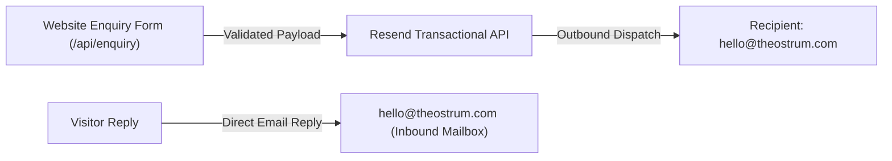

# OSTRUM — Resend Integration & Operational Setup Guide

**Date:** 9 November 2026  
**Repository:** `Balashanmugam30/Ostrum`  
**Target Domain:** `theostrum.com`  
**Planned Inbound Address:** `hello@theostrum.com`  
**Planned Outbound Sender:** `OSTRUM Website <website@theostrum.com>`

---

## 1. Architectural Architecture & Boundary



- **Resend** is an outbound transactional delivery engine; it does NOT provide an inbound mailbox or email storage.
- An inbound mailbox must be provisioned separately (e.g. Google Workspace, Zoho, Microsoft 365, or Cloudflare Email Routing) to receive enquiries sent to `hello@theostrum.com`.
- The website enquiry API configures `replyTo: clientEmail`, ensuring replies from studio partners go directly to the prospective client.

---

## 2. Resend MCP Connection Status

The official Resend MCP endpoint (`https://mcp.resend.com/mcp`) has been added to Antigravity's MCP configuration (`~/.gemini/config/mcp_config.json`).

```json
{
  "mcpServers": {
    "resend": {
      "command": "npx",
      "args": ["-y", "mcp-remote", "https://mcp.resend.com/mcp"]
    }
  }
}
```

- **Status:** Integrated. Authentication is conducted via browser-based OAuth upon first interactive invocation.
- **Safety Standard:** No long-lived API keys are stored in source code or local JSON configs.

---

## 3. Sending Domain DNS Configuration

In the Resend dashboard, add the domain `theostrum.com` (or subdomain `notify.theostrum.com`). Resend will generate unique cryptographic verification tokens.

| Record Type | Hostname / Name | Value / Target | Purpose | Proxy Status (Cloudflare) |
|---|---|---|---|---|
| **TXT** | `resend._domainkey.theostrum.com` | `[Resend DKIM Key - provided in dashboard]` | DKIM cryptographic signature verification | DNS-only (Grey cloud) |
| **TXT** (or **CNAME**) | `bounces.theostrum.com` | `[Resend Return-Path SPF target]` | SPF return-path verification | DNS-only (Grey cloud) |
| **MX** | `bounces.theostrum.com` | `feedback-smtp.resend.com` (Priority: 10) | Resend bounce and complaint return-path | DNS-only (Grey cloud) |
| **TXT** | `_dmarc.theostrum.com` | `v=DMARC1; p=none; rua=mailto:dmarc-reports@theostrum.com;` | DMARC policy (monitoring mode) | DNS-only (Grey cloud) |

> [!IMPORTANT]
> **Cloudflare Proxy Rule:** All mail-related verification records (DKIM, SPF, MX) MUST be set to **DNS-only (Grey cloud)**. Never orange-cloud proxy email records.
> **Preserve Inbound MX:** Never overwrite or replace apex `theostrum.com` MX records used by your receiving mailbox provider.

---

## 4. Least-Privilege API Key Generation

Once domain verification is confirmed in the Resend dashboard:
1. Navigate to **API Keys** -> **Create API Key**.
2. **Name:** `OSTRUM Production Enquiry`.
3. **Permissions:** Select **Sending access only** (do NOT grant Full Access).
4. **Domain Restriction:** Restrict to `theostrum.com`.
5. Copy the generated key value once directly into Vercel Project Settings (Production Environment Variables) under `RESEND_API_KEY`.
6. Never paste or commit the raw API key into Git, chat, or documentation.

---

## 5. Controlled Pre-Launch Test Plan

After configuring DNS and environment variables on a staging or preview deployment:

1. **Controlled Enquiry Test:**
   - Submit a test enquiry via the `/` contact form using synthetic details:
     - Name: `Ostrum Staging Test`
     - Email: `owner-test-mailbox@domain.com`
     - Project Type: `Custom Software & Business Platforms`
     - Details: `Automated pre-deployment verification ping.`
2. **Validation Gates:**
   - Confirm API returns HTTP 200 with `{ "success": true, "message": "Thank you for reaching out..." }`.
   - Inspect Resend dashboard **Emails** log to confirm delivery status changes to **Delivered**.
   - Check the receiving inbox (`hello@theostrum.com`) and confirm message arrival without being flagged as spam.
   - Verify that clicking "Reply" populates `owner-test-mailbox@domain.com` in the `To:` field.
3. **Negative Tests:**
   - Submit empty payload -> verify HTTP 400.
   - Submit payload > 64 KB -> verify HTTP 413.
   - Submit 6 rapid requests -> verify 6th request receives HTTP 429 (`Retry-After: 600`).

---

## 6. Incident Response & Key Rotation

- **Key Compromise:** If an API key is inadvertently exposed, immediately revoke it in the Resend dashboard (**API Keys** -> **Revoke**), generate a replacement key, and update Vercel Production environment variables.
- **Delivery Failure:** If Resend returns HTTP 502/503 or bounce rates increase, check the Resend dashboard **Suppression List** to ensure `hello@theostrum.com` has not been placed on suppression due to past hard bounces.
